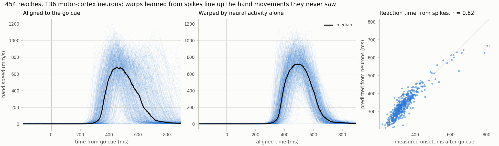
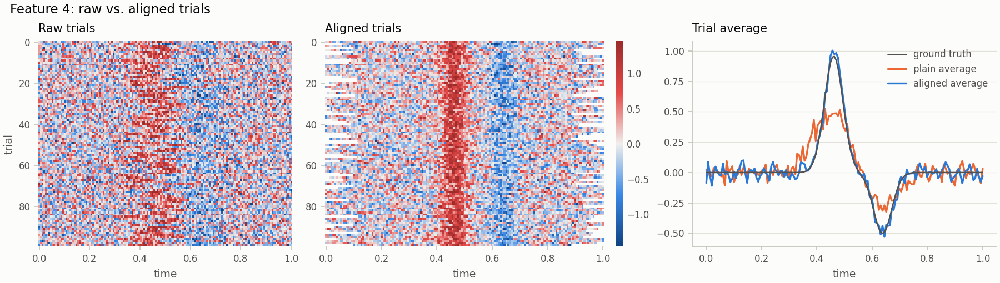
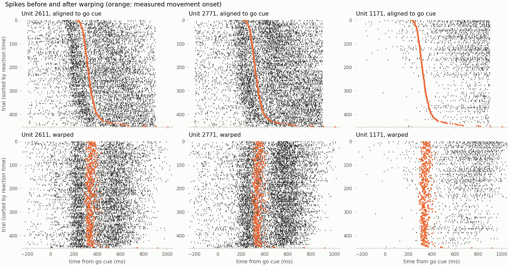
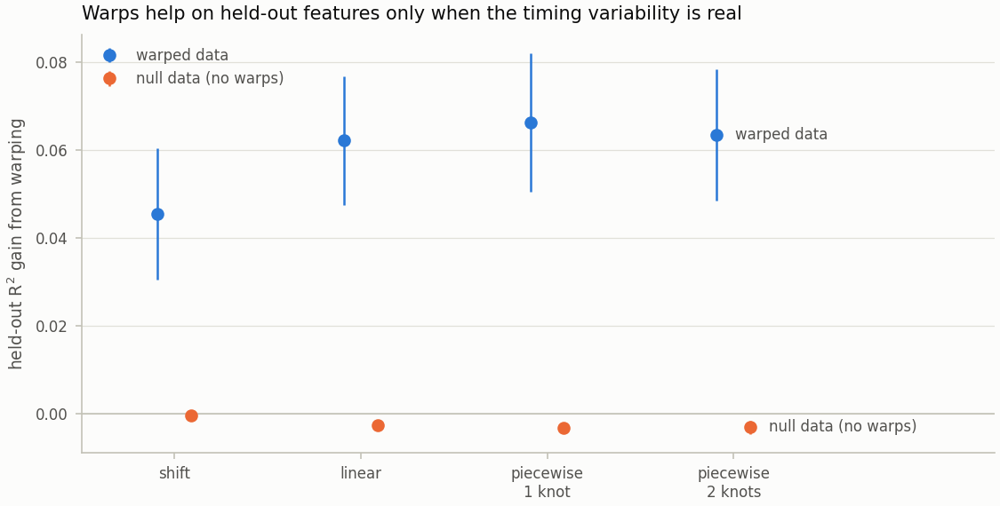

# trialwarp

[](https://github.com/captaincereal/trialwarp/actions/workflows/ci.yml)

[](LICENSE)
[](https://github.com/astral-sh/ruff)

**Line up repeated, noisy trials of multi-dimensional time series with shift, linear and
piecewise-linear time warping.**

Repeated trials of the same process rarely share exact timing: a neuron fires a little
earlier on one trial than the next, and a movement unfolds faster on some repetitions. A
plain trial average smears every timing-locked feature into a low, wide bump. `trialwarp`
learns a shared **template** plus one **warping function per trial**, from the data alone,
and puts every trial back on a common clock.



**On real recordings:** in 454 reaches by a macaque, warps learned only from
136 motor-cortex neurons predict each trial's movement onset (r = 0.82). They also line up
the hand-speed profiles the model never saw, as well as aligning on the measured movement
itself. [Read the case study →](case_studies/README.md)

## Highlights

- **Three warp families, one API.** Choose `ShiftWarping`, `LinearWarping`, or
  `PiecewiseWarping(n_knots=k)`, with `fit`, `transform`, `predict` and `transform_events`
  on all three. A simple fit can initialize a more flexible one.
- **Robust fitting.** Each round scores every trial against a shared dictionary of candidate
  warps with a few matrix products, then refines each trial with a short local search.
  The template update is an exact banded least-squares solve.
- **Honest validation.** `heldout_feature_score` asks whether warps learned from some
  features (neurons) improve predictions of held-out features on held-out trials. It is
  tested against null data, where it correctly reports no gain.
- **Ready for neural data.** Bin and smooth spikes. Warp raw spike times and behavioral
  events onto the aligned clock. Fit on smoothed rates and transform anything recorded on
  the same trials, even at another sampling rate.
- **Practical.** Missing data (NaN) and ragged trials are handled. Many-feature data is
  scored in the template's principal subspace (exact, faster). The only dependencies are
  NumPy and SciPy, and the package is typed and tested on Python 3.11–3.14 (Linux, macOS,
  Windows).

## Where it helps

Anything recorded as repeated "trials" of one process whose timing varies:

| field | one trial is | features | what the warps capture |
|---|---|---|---|
| systems neuroscience | a behavioral trial | spike trains, calcium traces, LFP | reaction-time and movement-speed variability ([case study](case_studies/README.md)) |
| EEG / MEG | an event-related epoch | channels | ERP latency jitter, a multichannel, piecewise generalization of Woody's latency correction |
| motor control, biomechanics | a reach, step or gait cycle | joint angles, EMG, kinematics | phase timing within the movement |
| speech and audio | an utterance of the same word | spectrogram or MFCC bands | speaking rate and phoneme durations |
| cardiology, physiology | a heartbeat or breath | ECG leads, flow, pressure | rate-dependent intervals, such as QT |
| manufacturing, bioprocesses | a production batch | sensor trajectories | phase durations that differ from batch to batch |
| environmental science | a year | streamflow, temperature, NDVI | seasonal timing shifts, such as snowmelt or green-up |

## Installation

```bash
pip install "trialwarp[plot] @ git+https://github.com/captaincereal/trialwarp"
```

Or from a clone (Python 3.11 or newer):

```bash
pip install -e ".[plot]"              # numpy + scipy, plus matplotlib for plots
pip install -e ".[case-studies]"      # adds h5py for the real-data case study
pip install --group dev               # tests, linting, notebook (pip >= 25.1)
```

With [uv](https://docs.astral.sh/uv/), `uv sync --all-extras --all-groups` sets up everything.

## Quickstart

```python
import trialwarp as tw

# X: array of shape (n_trials, n_timepoints, n_features); NaN marks missing samples
data = tw.make_warped_trials(n_trials=100, n_timepoints=150, n_features=10, random_state=0)
X = data.data

linear = tw.LinearWarping(random_state=0).fit(X)  # shift + stretch
model = tw.PiecewiseWarping(n_knots=1, random_state=0).fit(X, init=linear)

aligned = model.transform(X)  # every trial resampled onto the template's clock
template = model.template_  # (n_timepoints, n_features)
warps = model.warping_functions()  # (n_trials, n_timepoints): trial time -> template time
reconstruction = model.predict()  # template read out through each trial's warp
```

On this synthetic data set, the R² of each estimate against the true template
(`examples/01_quickstart.py`) is:

| estimate | R² vs. truth |
|---|---|
| plain trial average | 0.636 |
| average of aligned trials | 0.957 |
| warped template (`model.template_`) | 0.985 |



## Models

| class | warping function | when to use |
|---|---|---|
| `ShiftWarping` | `ω(t) = t + shift` | trials differ only by a delay; exhaustive search, fast |
| `LinearWarping` | `ω(t) = a + b·t` | trials are also uniformly faster or slower |
| `PiecewiseWarping(n_knots=k)` | `k + 1` linear segments | different parts of a trial stretch by different amounts |

### How it works

Trial `k` is modeled as the template read out through a monotone, piecewise-linear warp:

```
X[k, t, :]  ≈  template(ω_k(t))         t = normalized trial time in [0, 1]
```

Fitting alternates two steps, each of which can only lower the objective:

1. **Warps.** Every trial is scored against a shared dictionary of candidate warps (a grid
   of shifts and stretches plus random piecewise warps). Because candidates are shared, all
   scores reduce to a few matrix products. A short per-trial stochastic local search then
   refines each warp.
2. **Template.** With the warps fixed, the prediction is linear in the template, so the best
   template solves a banded (pentadiagonal) least-squares problem with a roughness penalty.

The objective is normalized so its weights mean the same thing on any data set:

```
loss = mean squared residual / variance of X
     + warp_reg * mean_k ∫ (ω_k(t) − t)² dt
     + template roughness penalty
```

## Neural data: spikes, rasters and behavioral events

Fit on smoothed rates, then warp the raw spike times and event times. Rasters are drawn on
the aligned clock without re-binning:

```python
counts, centers = tw.bin_spikes(
    trials, times, neurons, n_trials=K, n_units=N, n_bins=100, tmin=0.0, tmax=1.0
)
rates = tw.smooth_trials(counts, sigma=2.0)
model = tw.PiecewiseWarping(n_knots=1, random_state=0).fit(rates)

clock = dict(tmin=centers[0], tmax=centers[-1])  # times of the first/last sample
aligned_spikes = model.transform_events(trials, times, **clock)
aligned_events = model.transform_events(range(K), movement_onset, **clock)
```



## Is the warping real?

Warping always lowers the training loss, even on pure noise, so the loss cannot tell you
whether trial-to-trial timing variability exists. `heldout_feature_score` runs a double
cross-validation. Warps are fitted on all but one fold of the features. For the held-out
features, a template is fitted on all but one fold of the trials and must predict the
remaining trials, read out through their warps. The baseline is the same prediction with
identity warps, and the held-out data are never resampled.

```python
score = tw.heldout_feature_score(tw.PiecewiseWarping(n_knots=1), X, random_state=0)
print(score)  # per-fold R² without and with warping, and the improvement
```

A consistently positive improvement means the warps generalize to data the model never
saw. Use the same score to choose between models and regularization strengths. On data
generated without warps, every model scores at or below zero
(`examples/03_model_selection.py`):



## Parameters

| parameter | default | meaning |
|---|---|---|
| `n_knots` | 1 | interior knots per warp (`PiecewiseWarping` only) |
| `warp_reg` | 1.0 | weight of the penalty pulling warps toward the identity; raise it if the held-out gain is small or negative |
| `max_lag` | 0.3 (0.2 for shifts) | hard limit on how far a warp moves any moment, `abs(ω(t) − t)`, as a fraction of the trial |
| `max_stretch` | 3.0 | segment slopes stay within `[1/max_stretch, max_stretch]` |
| `smoothness` | 0.01 | template smoothing timescale, as a fraction of the trial (0 = off) |
| `l2_reg` | 0.0 | ridge penalty on the template |
| `n_bins` | `n_timepoints` | number of template samples |
| `random_state` | `None` | seed for the randomized search |

Search budget (arguments of `fit`): `n_iter=20` rounds, `n_proposals=10` local-search steps
per trial and round, and `n_candidates=100` random candidate warps per round. The defaults
were tuned on synthetic benchmarks, and larger budgets mostly fit noise.

Tips:

- **Scale.** Each feature contributes in proportion to its variance. For spike data, use
  square-root firing rates or z-score features with very different scales.
- **Spikes.** Fit on smoothed rates (`smooth_trials`) and transform the raw spike times.
- **Time units.** Warps live in normalized time, where 0 is the first sample and 1 is the last.
  `transform` works on any array with the same trials, even at another sampling rate.
  `transform_events` accepts `tmin` and `tmax` so times can stay in seconds.

## Examples and case studies

| file | what it shows |
|---|---|
| [`case_studies/`](case_studies/README.md) | **real data:** macaque motor cortex (MC_Maze), with warps validated against measured behavior |
| [`examples/01_quickstart.py`](examples/01_quickstart.py) | fit, align, compare plain averaging with the warped template, true vs. estimated warps |
| [`examples/02_neural_spikes.py`](examples/02_neural_spikes.py) | simulated spike trains: binning, smoothing, warped rasters, behavioral events |
| [`examples/03_model_selection.py`](examples/03_model_selection.py) | choosing a model with held-out validation, with a null control |
| [`examples/tutorial.ipynb`](examples/tutorial.ipynb) | a narrated walkthrough, with outputs |

Run a script from the project root with `python examples/01_quickstart.py`. Add
`--no-show` to only write the figures.

## API overview

- Models: `ShiftWarping`, `LinearWarping`, `PiecewiseWarping`
- Validation: `heldout_feature_score`, `trial_consistency`, `clone`
- Neural helpers: `bin_spikes`, `smooth_trials`
- Synthetic data: `make_warped_trials`, `make_spike_trials`
- Warp utilities: `evaluate_warps`, `invert_warps`
- Plots (`trialwarp.plotting`): `plot_alignment`, `plot_trials`, `plot_averages`,
  `plot_warps`, `plot_loss`, `plot_raster`, plus the `style()` context manager

Every public function and class has a NumPy-style docstring with the details.

## Development

```bash
pip install -e ".[plot]" && pip install --group dev
pytest                      # 61 tests, ~10 s
ruff check . && ruff format --check .
```

CI runs the tests on Python 3.11–3.14 (Linux), Windows and macOS. A separate job runs them
on the oldest supported versions (NumPy 1.26, SciPy 1.11, Matplotlib 3.8).

## Background and citation

The model (a shared template plus shift, linear or piecewise-linear warps, fitted by
alternating minimization with a roughness-penalized template) follows:

> Williams, A. H., Poole, B., Maheswaranathan, N., et al. (2020). Discovering precise
> temporal patterns in large-scale neural recordings through robust and interpretable time
> warping. *Neuron*, 105(2), 246–259.e8. https://doi.org/10.1016/j.neuron.2019.10.020

The authors' reference implementation is [`affinewarp`](https://github.com/ahwillia/affinewarp).
`trialwarp` is an independent implementation. Its additions are a shared-candidate global
search scored with matrix products, an exact principal-subspace speedup, a doubly
cross-validated held-out score, and support for missing data. If it helps your research,
please cite the paper above (see also [`CITATION.cff`](CITATION.cff)).

The case study uses MC_Maze data by Churchland and Kaufman (DANDI archive, CC-BY-4.0);
see the [case study](case_studies/README.md#data-credit) for the full credit.

## License

MIT. See [LICENSE](LICENSE).
