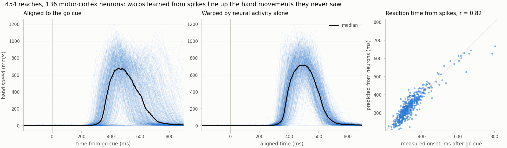
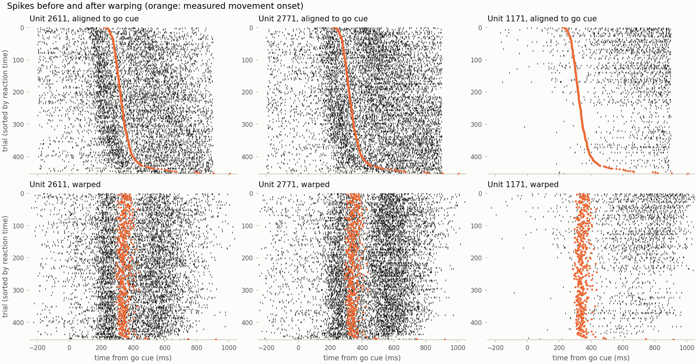

# Case study: recovering reach timing from motor cortex activity alone



## The question

A monkey waits for a go cue, then reaches to a target. Its **reaction time varies from
trial to trial**: in this data set the middle 90% of trials start moving 260–506 ms
after the cue. Experiments usually align trials to the go cue, the one event the
experimenter controls. Every movement-related neural signal is then smeared across
trials, and the trial-averaged firing rates (PSTHs) blur.

Can `trialwarp` find each trial's timing **from the neural activity alone, without
looking at the behavior**? If it can, the warps it learns from spikes should also line up
the hand movements, a signal the model never sees.

## Data

**MC_Maze_Large** (Churchland & Kaufman), from the [Neural Latents Benchmark](https://neurallatents.github.io/).
A macaque makes delayed reaches through a maze while Utah arrays record single and
multi-units in primary motor and dorsal premotor cortex. The data are distributed by the
DANDI archive under CC-BY-4.0. The script downloads the published, immutable version
(149 MB) and checks its SHA-256 checksum.

| | |
|---|---|
| trials | 500 successful reaches in 9 conditions; we keep the 454 whose target appeared at least 200 ms before the go cue |
| neurons | 162 units; we keep the 136 firing at least 1 Hz around the reach |
| behavior | measured movement onset per trial; hand velocity at 1 kHz |

## Method

1. **Window.** Take −200 to +900 ms around the go cue in 10 ms bins, smooth with a
   Gaussian (σ = 20 ms), and square-root the firing rates so that high-rate neurons do not
   dominate.
2. **Fit.** One `PiecewiseWarping(n_knots=1)` model with default settings, fitted to the
   neural data only: one shared template for all 454 reaches and one warp per trial.
3. **Validate on behavior the model never saw:**
   - map a single marker on the template clock (the median movement onset) back through
     each trial's warp, and compare the predicted onset with the measured one;
   - apply the warps to the 1 kHz hand-speed traces, and measure how consistent the trials
     become (leave-one-out R² of each trial against the average of the others).
4. **Cross-validate on neurons.** Fit warps on 4/5 of the neurons and predict held-out
   trials of the remaining neurons (`trialwarp.heldout_feature_score`).

## Results

| alignment | r, predicted vs. measured onset | median onset error (ms) | spread of measured onsets, IQR (ms) | hand-speed consistency |
|---|---|---|---|---|
| no warping (go-cue aligned) | – | – | 65 | 0.593 |
| aligned on measured movement onset (behavioral oracle) | – | – | 0 | 0.833 |
| `ShiftWarping` | 0.77 | 15 | 29 | 0.804 |
| `LinearWarping` | 0.76 | 16 | 31 | **0.844** |
| **`PiecewiseWarping(n_knots=1)`** | **0.82** | 18 | 37 | 0.828 |
| `PiecewiseWarping(n_knots=2)` | 0.79 | 16 | 35 | 0.827 |

- **Neural activity alone predicts each reach's onset.** The one-knot piecewise model
  predicts movement onset with r = 0.82, a median error of 18 ms.
- **The warps line up the hand.** Applying the spike-derived warps to the hand-speed traces
  lifts trial-to-trial consistency from 0.59 to 0.83. That equals realigning every trial on
  its measured movement onset (0.83), an alignment that needs the behavior.
- **Linear warps beat the behavioral oracle.** They reach 0.84 because they also absorb
  differences in movement duration, which a single onset time cannot.
- **The warps generalize across neurons.** Warps fitted on 4/5 of the neurons improve
  predictions of held-out neurons' single trials in every fold: cross-validated R² rises
  from 0.062 to 0.086, a gain of +0.024 ± 0.004 over 5 folds.



Trials are sorted by measured reaction time for display only (the model never sees this
order). Aligned to the go cue, the movement-onset markers (orange) trace a curve, and
the neurons' bursts follow it. After warping, both collapse into vertical bands.

## Caveats

- **Slow trials.** 14 trials have reaction times above 600 ms. Their shift exceeds the
  default `max_lag` of 30% of the window, so they cannot be fully aligned.
- **Pooled template.** One template is shared by all 9 reach directions. Fitting each
  direction separately gives similar onset predictions (r = 0.80–0.83 in our tests). The
  pooled model relies on the large condition-invariant movement signal in motor cortex.
- **Low R² is expected.** Single-trial spike counts are sparse and noisy, so held-out R²
  values are small in absolute terms. The relative gain from warping is what matters.
- **One calibration constant.** It places the movement-onset marker on the template clock.
  Each trial's prediction comes from its neural warp alone.

## Reproduce

From the repository root:

```bash
pip install -e ".[case-studies]"
python case_studies/mc_maze_reaching.py            # downloads 149 MB once, ~3 min
python case_studies/mc_maze_reaching.py --crossval # adds the held-out-neuron check
python case_studies/mc_maze_reaching.py --dataset small   # 29 MB version
```

Data are cached in `~/.cache/trialwarp` (change it with `--data-dir`).

## Data credit

> Churchland, Mark; Kaufman, Matthew (2022). MC_Maze_Large: macaque primary motor and
> dorsal premotor cortex spiking activity during delayed reaching (Version 0.220113.0407)
> [Data set]. DANDI archive. https://doi.org/10.48324/dandi.000138/0.220113.0407

Related publications: Churchland et al., *Nature* 487, 51–56 (2012),
https://doi.org/10.1038/nature11129; Churchland et al., *Neuron* 68, 387–400 (2010),
https://doi.org/10.1016/j.neuron.2010.09.015; and the Neural Latents Benchmark
(Pei et al., 2021, https://arxiv.org/abs/2109.04463).
